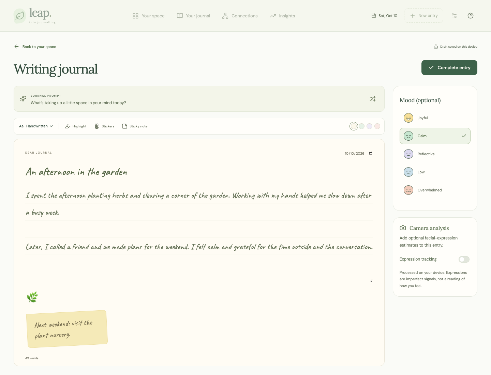
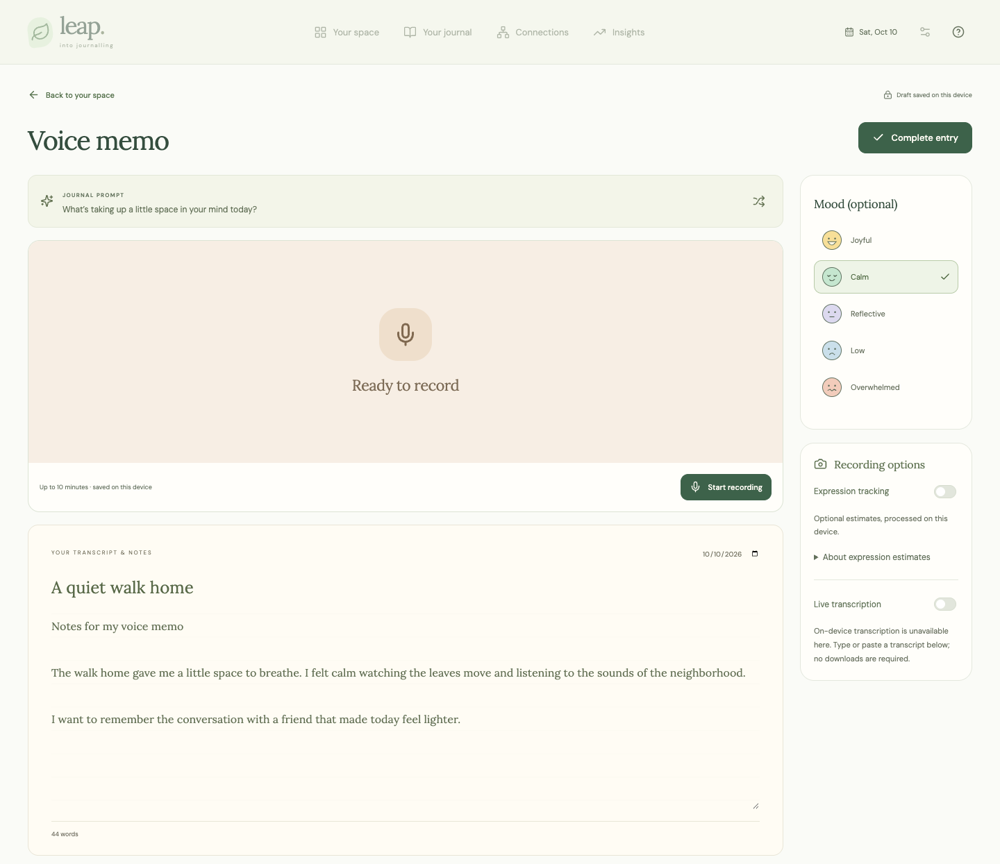
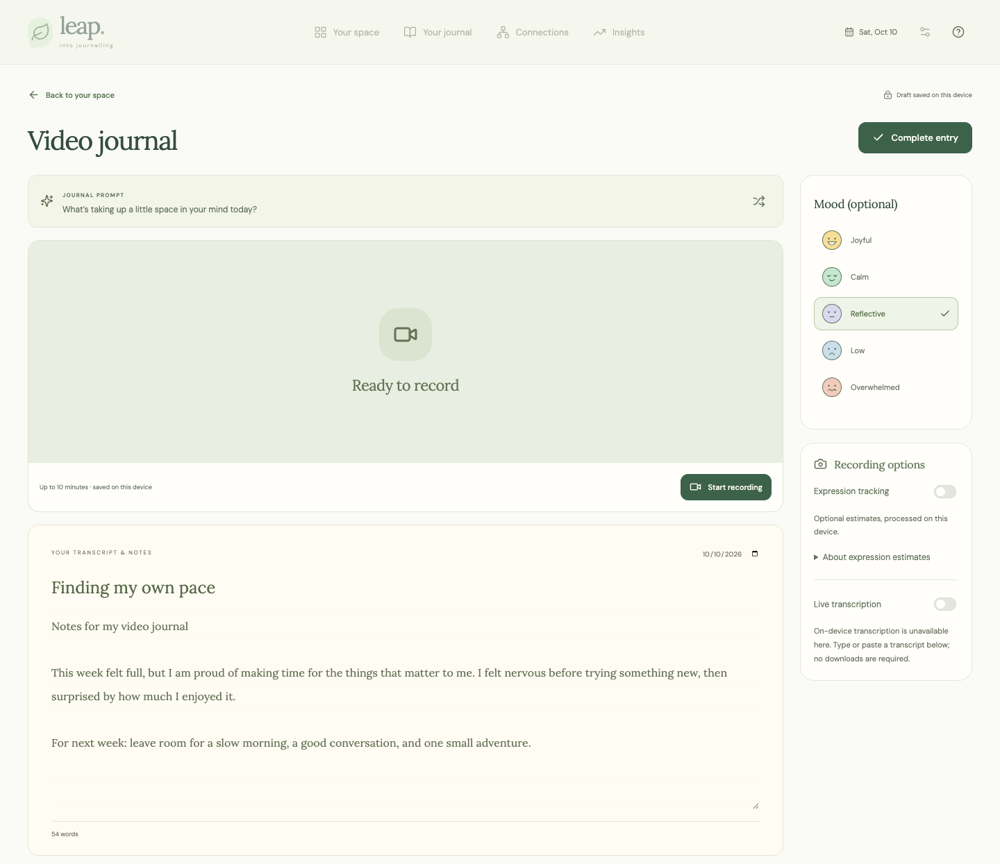
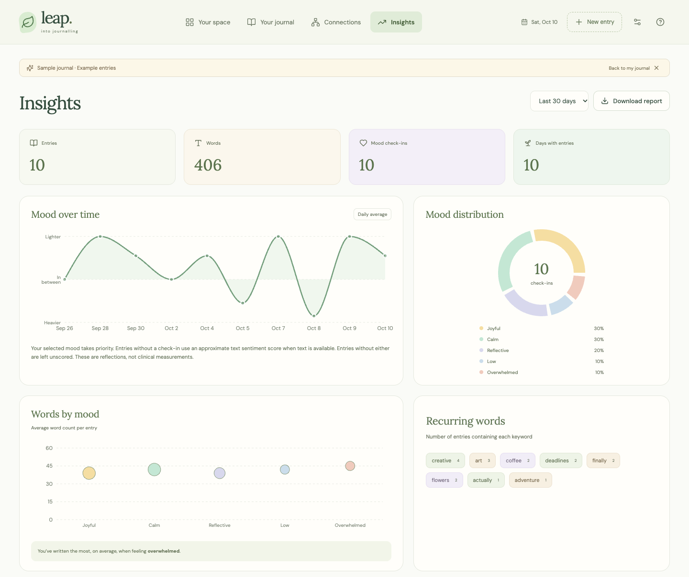

# Leap Into Journalling

A browser-based journal for writing, voice, and video, with on-device emotion estimates, editable emotion labels, connected-entry graphs, and downloadable insights reports. 

## Screenshots

Screenshots use fictional journal entries.

| Home | Writing editor |
| --- | --- |
|  |  |

| Voice journal | Video journal |
| --- | --- |
|  |  |

| Connections | Insights |
| --- | --- |
|  |  |

## Run locally

Use Node.js 22 LTS and npm. `.nvmrc` and `package.json` select the same Node major version for local development and Vercel builds.

```sh
nvm use            # If you use nvm; install Node 22 first with nvm install
npm ci
npm run dev
```

Open the URL printed by Vite (normally `http://127.0.0.1:5173`). Camera and microphone recording require localhost or HTTPS. No API keys or backend services are needed.

```sh
npm run build       # Typecheck and create dist/
npm run preview     # Preview the production build
npm test            # Analysis, media measurements, corrections, and storage tests
npx playwright test # With the dev server running; uses installed Google Chrome
```

Browser tests use synthetic camera/microphone input and isolated browser profiles. They never open your real camera or microphone. For another Chromium install, change `launchOptions.channel` in `playwright.config.ts`.

Deployment validation passed 63 unit tests, all 27 browser checks against the production build, and a clean installation/build with Node 22. The dependency audit reported no known vulnerabilities. The UI audit covers the main screens and dialogs at desktop and mobile sizes; see [audit notes](docs/ui-audit.md). These checks verify application behavior; model accuracy and its limitations are documented in the [evaluation notes](docs/multimodal-evaluation.md).

## Included

- Writing journal with four fonts, four paper colors, page highlighting, movable and resizable stickers with white borders, sticky notes, mood check-ins, entry dates, and debounced text draft autosave.
- Video and voice recording, up to ten minutes per entry, with playback, duration, downloadable recordings, and editable transcripts. Unsaved recording navigation prompts prevent accidental loss.
- 120 writing prompts and 520 shared video/voice prompts, built from curated subjects and reflection frames. Shuffle avoids immediately repeating the same prompt.
- Optional camera expression estimates in every mode. Voice mode saves only the audio track. Writing mode saves expression measurements, not camera footage.
- Optional **on-device-only** English transcription. Supported browsers must provide local recognition; cloud-capable legacy recognition is never used as a fallback. Recognition is used only when already available on the device; the app never installs or requests language packs. Native passages retain approximate recording times and can be reviewed after saving; manual transcripts work everywhere.
- IndexedDB stores entry text, decoration, sentiment, expression samples, acoustic measurements, and recording blobs atomically. Search, mode/mood filters, entry details, and confirmed deletion are included.
- Local emotion review supports several labels or confirmed none, with corrections applied to charts, graph connections, and reports.
- Full JSON backup and restore include recordings, corrections, timed passages and acoustic measurements. Version 3 backups retain compatibility with versions 1 and 2. Restore validates all records before committing and merges by ID. Individual recordings can also be downloaded.
- A responsive, keyboard-operable graph with date lookup, entry selection, zoom, shared keywords, and ranked matches. Scroll or focus nodes to explore while zoomed; selecting an entry fits its connections back into view. The graph shows up to eight content matches around the selected entry; all entries remain selectable and participate in ranking. Expand recurring topics to review supporting entries across at least three distinct days.
- Daily mood and text-emotion charts, self-reported mood distribution, word counts by mood and emotion, recurring keywords, and date filters.
- An explicitly labeled sample journal that never enters personal storage or backups.

## Review an entry’s emotions and transcript

1. Save an entry, then open it from your journal.
2. Select **Review emotion labels**. Choose any combination of joy, sadness, anger, fear, disgust, and surprise, or **Clear all** to confirm that none fits.
3. Select **Save emotion labels**. Your choices take priority in Insights, Connections, and PDF reports. To remove a correction, reopen the review and select **Use automatic estimates**.

**Text evidence** shows the passages supporting the automatic labels, their coverage, and any excluded passages. Coverage and model strength describe evidence in the writing; they are not probabilities of how you feel.

For voice and video entries, **Review transcript** lets you correct saved text and recomputes its automatic analysis on this device. Captured speech passages include approximate playback times. **Signals by passage** compares available text and facial estimates without treating disagreements as a single emotion. Manual or freely edited transcripts can still be analyzed, but timing comparisons are disabled when they no longer match the recorded passages. User-confirmed emotion labels remain in place when a transcript is edited.

## How the signals work

On **Insights**, choose a date range and select **Download report** to create an A4 PDF locally. The report includes mood counts, recurring words, a vector timeline with a daily values table, score sources, and limitations. An optional note adds context for the reader. Full journal titles and text/transcripts are included only when selected; recordings, camera data, and decorative notes are excluded. Sample reports are clearly labeled. Embedded fonts and selectable text make the report suitable for reading, printing, and uploading to an AI conversation. Characters outside the embedded font's coverage use reversible `[U+XXXX]` notation rather than disappearing. The PDF generator and fonts load only when a download is requested. Nothing is uploaded automatically.

Text sentiment runs entirely on the device using [VADER](https://github.com/cjhutto/vaderSentiment), through the zero-dependency [`vader-sentiment`](https://github.com/nimaeskandary/vaderSentiment-js) JavaScript package (pinned to 1.1.3). Its larger lexicon and rules account for intensifiers, negation, capitalization, punctuation, emoticons, and contrast with “but.” Leap normalizes curly apostrophes and common negation patterns, scores each sentence separately, and averages scores by word count. Very long sentences are processed in chunks of 400 words without truncating the entry. The dictionary and algorithm ship with the static app; no neural model weights, external sentiment requests, API keys, or server functions are needed.

Specific **text emotions** use a separate compact, multi-label linear classifier trained on the public [GoEmotions dataset](https://github.com/google-research/google-research/tree/master/goemotions). It estimates **joy, sadness, anger, fear, disgust, and surprise**, using Google's broad Ekman grouping. Its weights are about **221 KB compressed**; inference is plain TypeScript with no extra runtime dependency, model service, or build-time training. Passage-level processing preserves mixed emotions, tags past/current/anticipated language, and excludes recognized quotations, hypothetical statements, sarcasm cues, and other-person descriptions, with a small rule layer recognizing explicit statements such as “I am angry” or “I feel happy and sad.” Conservative thresholds, evidence checks, and negation masking leave uncertain text unlabeled. This is a small model with limited recall, not the large RoBERTa GoEmotions model. See the [model documentation, limitations, and reproducible evaluation](docs/emotion-model.md).

Existing entries are reanalyzed locally when loaded, and imported backups are reanalyzed from their original text; text, recordings, and mood check-ins are preserved. The method and version accompany saved estimates. `analysis.emotions` contains specific emotion profile weights; VADER's positive/negative/neutral proportions live separately in `analysis.polarity`. Neither is a probability of someone's actual feelings. `analysis.evidence` separately records evidence-word coverage, raw model/rule strength and a conservative reliability weight. User-confirmed labels override the text profile without changing the saved automatic analysis. Mood check-ins take precedence in the mood timeline. Text-emotion charts count entries with each label, including writing and saved voice/video transcripts; mixed entries can count in multiple categories. PDFs include the same emotion counts and average words, with separate counts for user labels and automatic estimates.

Connections require shared content in writing or transcripts. A local TF–IDF index compares words and normalized phrases, groups a small curated set of English variants and synonyms (for example, boss/manager and office/work), and excludes common filler and emotion words from topic evidence. Exact copies of the selected prompt are ignored. Titles add context but cannot establish a link by themselves. Content contributes at least 80% of the ranking weight; reliable text emotions contribute up to 12%, mood check-ins up to 5%, and quality-checked, aligned facial estimates up to 3%. A matching mood or emotion alone never creates a connection, and entries with contrasting feelings can still connect through shared topics.

The graph shows up to eight matches, numbers them to match the readable entry list, and limits secondary links to two per surrounding node. Recurring-topic groups require three entries across at least three different days and link to their source entries. These are inspectable text patterns, not causal conclusions or a general semantic model; synonyms, context, negation and non-English writing can still be missed or misinterpreted. Corpus vectors and pair comparisons are reused locally, with no new dependencies, downloads, or service calls. User corrections still take priority for emotion comparisons; text and its transcript count as one source.

Facial-expression inference uses [`@vladmandic/human`](https://github.com/vladmandic/human). Only the face detector and emotion model are enabled; age, gender, identity, body, and hand models are disabled. The build copies the required model files into `public/models/`, so journal data never goes to a model CDN. See the [upstream model credits](https://github.com/vladmandic/human/wiki/Models). The JS model bundle loads only after the user enables camera analysis. Samples are rejected for poor lighting, blur, framing, detector confidence, or rough landmark-based pose; these checks cannot guarantee detection of every obstruction. A short exponential smoother resets after bad frames or a five-second gap. Raw and smoothed scores are retained. Expression predictions can be wrong and do not establish someone's emotional state.

Voice uses Web Audio for RMS, pitch/periodicity, zero-crossing rate, clipping and approximate unvoiced-frame share. These are acoustic observations, not emotion labels. A tiny vocal-emotion pilot was tested on a bounded public dataset and failed to demonstrate sufficient accuracy, so no voice-emotion model is bundled or enabled. The existing text model also outperformed an authored journal-style retraining candidate on the held-out benchmark; the candidate was not promoted. An optional AffectNet model was tested for loading and latency only and remains outside the app. See [evaluation results and reproduction commands](docs/multimodal-evaluation.md).

## Privacy and storage limits

- No journal backend, analytics, cloud sync, or accounts. This browser's origin is the storage boundary; local development and a hosted version have separate journals. Use backup/restore to move data.
- Data is not encrypted. Anyone with access to this browser profile may access the journal. Backups are also unencrypted.
- Clearing site data or browser storage eviction can remove entries. Download backups regularly. Imports are limited to 100 MB; media storage depends on the browser's quota.
- Text drafts autosave locally. Media recordings remain in memory until **Complete entry**; reloading or closing the tab can lose an unsaved recording even if a browser warning appears.
- Native local speech recognition is experimental and browser-dependent. Leap requires [`processLocally`](https://developer.mozilla.org/en-US/docs/Web/API/SpeechRecognition/processLocally), checks local pack availability, and never silently falls back to remote recognition. No speech-pack installation or model-download flow is offered. If a browser needs a pack or cannot guarantee on-device recognition, live transcription stays unavailable and the user can type or paste a transcript. Automatic transcription without an already-available local service would require a cloud service; it is not enabled.
- Automated checks cover Chrome with synthetic media, local model loading, storage persistence, backups, failure recovery, and mobile layout. Real local-speech accuracy, facial-expression accuracy, and other browsers require device testing.

## Project layout

`src/App.tsx` contains the application shell and journal library. `src/components/` contains the editor, graph, charts, illustrations, and modal. `src/lib/` contains storage, analysis, prompts, demo data, and the media capture hook. Fonts, illustrations, and model assets are self-hosted. `scripts/copy-models.mjs` runs before development and production builds.

`vercel.json` configures static deployment of `dist/`. Generated output, local Vercel project metadata, and environment files are excluded from Git.
